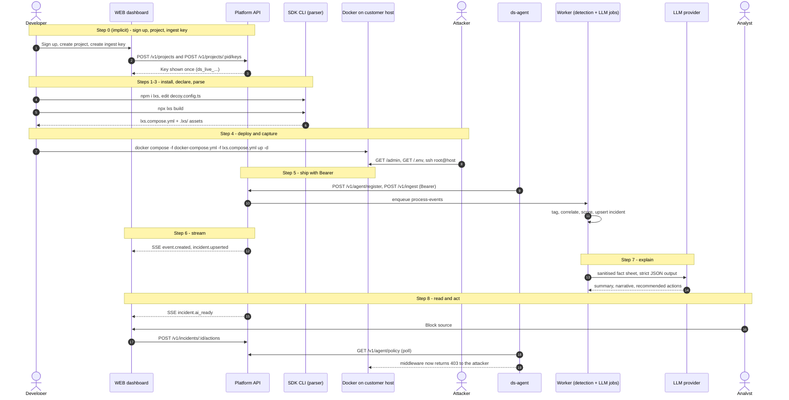

# BREAKDOWN.md — LXS (PS04)

### Honeypots-as-code for developers, plus a SOC dashboard that turns decoy hits into explained, actionable attack chains

| | |
|---|---|
| Document | Engineering blueprint: understanding, scope, architecture, stack, SDK, dashboard, honeypots, backend, security, repo, build plan, testing, docs, decisions |
| Version / date | v1.0 · 31 Oct 2026 |
| Hackathon / problem | D3COY · **PS04: Deception-Driven Threat Detection and Response — a SOC Dashboard Powered by a Honeypot Network** (title as recorded in S4) |
| Working product name | **LXS** (from S4). The whiteboard diagram uses the placeholders `toolname` and `mehoney` (`mehoney-compose.yml`). Final name and npm availability are an open question (§14.3). |
| Team assumption | 4 engineers, TypeScript-comfortable, one person comfortable with Linux/Docker networking, AI-assisted, ~24–36 h event (plan uses 30 working hours) |

**Sources used and how they rank**

| ID | Source | Weight |
|---|---|---|
| **S2** | The Excalidraw system diagram with numbered steps 1–8 | Primary reference for the end-to-end workflow (per the brief) |
| **S1** | Earlier conversation: PS04 plan, demo script, "SDK or SaaS?" answer, build roadmap | Confirmed intent where S2 is silent |
| **S4** | `LXS_End_to_End_Report.pdf` found in the uploads folder (38 pages, reviews the same sketch, includes a PS04 traceability matrix derived from the organisers' PDF) | Prior detailed design; adopted where it fits, overridden with stated reasons where it doesn't |
| **S3** | This task brief (TS/JS-first preference, Python allowed for honeypots and security tooling) | Governs stack choices and document structure |

`Genesis_Prototype-sam-fix.zip` (also in uploads) is a PS01 project and was **not** used.

**Label legend** used throughout: **[CONFIRMED]** stated in S1/S4 or visible in S2 · **[RECOMMENDED]** engineering choice made here · **[ASSUMPTION]** made so planning can continue · **[OPEN]** needs a team decision · **[DEFERRED]** not needed before MVP · **[CHANGED]** overrides an earlier source, with the reason given.

---

## Table of contents

0. [The short version](#0-the-short-version)
1. [Understanding the system](#1-understanding-the-system)
2. [Product scope and requirements](#2-product-scope-and-requirements)
3. [System architecture](#3-system-architecture)
4. [Technology stack](#4-technology-stack)
5. [The npm SDK](#5-the-npm-sdk)
6. [The web dashboard](#6-the-web-dashboard)
7. [Honeypots and security infrastructure](#7-honeypots-and-security-infrastructure)
8. [Backend, database and API](#8-backend-database-and-api)
9. [Security, reliability and scalability](#9-security-reliability-and-scalability)
10. [Repository and codebase structure](#10-repository-and-codebase-structure)
11. [Phase-by-phase implementation plan](#11-phase-by-phase-implementation-plan)
12. [Testing and validation](#12-testing-and-validation)
13. [Documentation and developer experience](#13-documentation-and-developer-experience)
14. [Decision register](#14-decision-register)
- [Appendix A — 5-minute demo script](#appendix-a--5-minute-demo-script)
- [Appendix B — Glossary](#appendix-b--glossary)

---

## 0. The short version

### 0.1 In plain words

Think of a shop. A honeypot is a fake door marked "Staff only — cash room" that no employee ever uses, so anyone who opens it is up to no good. The **SDK** is a kit that lets the shop owner install fake doors next to the real shop by writing a few lines of code (diagram steps 1–4). The **agent** is the alarm wire from the fake doors to the control room (step 5). The **dashboard** is the CCTV wall in the control room (step 6). The **LLM** is the colleague who writes a short, plain-English incident note so nobody has to watch raw footage (steps 7–8). The moment that matters most: when the person who opened the fake door then walks up to the real cash register, the alarm turns red (Critical), and the guard can lock that person out with one button.

### 0.2 What we build (three things, and only three)

1. **The SDK — `npm i lxs`.** A developer declares decoys in a config file (`t.create('web-admin', '/admin', {...})`). A CLI (the diagram's "Parser") compiles the declarations into `lxs.compose.yml` — the diagram's `mehoney-compose.yml`. A small middleware inside the app routes decoy paths to an isolated container, reports real-route hits from known attackers, and enforces blocks. *(Steps 1–4.)*
2. **The sensor stack** — containers generated by the SDK that run next to the customer's app: a web decoy container, a Cowrie SSH honeypot, and an agent that ships events to the platform with a Bearer key. *(Steps 4–5.)*
3. **The platform** — one TypeScript API (ingest, detection, incidents, response), PostgreSQL, an asynchronous LLM narrator, and a React dashboard fed by a live stream. *(Steps 5–8.)*

### 0.3 The twelve decisions that shape everything

| # | Decision | Status |
|---|---|---|
| D1 | The product is SDK-first honeypots-as-code backed by a central platform. The diagram's flow is the product. | [CONFIRMED] S2; S4 agrees; reconciles S1's "platform first, thin SDK" (§1.8 C1) |
| D2 | The parser runs at build time in the CLI. The app never touches the Docker socket and never starts containers. | [CONFIRMED] S4 Fix 1 |
| D3 | We write TypeScript everywhere (API, dashboard, SDK, agent, web decoys, simulator). The only non-TS component is **Cowrie** (Python, used as an upstream image, not code we maintain). | [RECOMMENDED] [CHANGED] from S1's Go backend and from S4's hand-built ssh2 shell |
| D4 | One modular-monolith API (Fastify) + **PostgreSQL** as the only stateful service (jobs via pg-boss, live fan-out via LISTEN/NOTIFY). No Redis, Kafka or microservices in MVP. | [RECOMMENDED] [CHANGED] from S4's SQLite |
| D5 | A sidecar **agent** is the only component that holds the platform credential. Decoys have no network path to the platform; they write logs to a volume the agent reads. | [RECOMMENDED] [CHANGED] from S4's "sensors post to the collector" |
| D6 | Web decoys run with **no network at all** (`network_mode: none`) and are reached by the app through a Unix socket. Network decoys (SSH, optional Redis) get inbound-only networking with all new outbound traffic dropped. | [RECOMMENDED] refines S1/S4 isolation |
| D7 | The control channel is **pull-only**: agents poll the platform; the platform never connects into customer infrastructure. | [RECOMMENDED] |
| D8 | Detection, ATT&CK mapping and severity are **deterministic rules** (S4's R01–R18 table, six kill-chain stages, master-prompt severity bands, three labels: noise / opportunistic / targeted). | [CONFIRMED] S1, S4 — with one refinement to R15 (§7.6) |
| D9 | The LLM **only explains**, at incident level, asynchronously, with a template fallback and prompt-injection defences. It never scores and never acts. | [CONFIRMED] S1, S4 |
| D10 | **Block source is real**: the middleware enforces the blocklist inside the customer app. Blocks expire and are reversible. "Isolate host" is not in the MVP. | [RECOMMENDED] upgrades S1's simulated firewall; drops S1/S4's simulated isolation |
| D11 | Live updates use **Server-Sent Events** (SSE), not WebSocket. | [RECOMMENDED] [CHANGED] low-stakes change from S1/S4 |
| D12 | Deception design uses **breadcrumbs and honeytokens**: decoys lead into each other and plant a fake API key that, if used on the real app, proves theft. | [CONFIRMED] S4 |

### 0.4 The MVP in one paragraph

A developer signs up, creates a project, copies an ingest key, runs `npm i lxs`, declares an `/admin` login decoy, bait files (`/.env`, `/backup.sql`) and an SSH decoy, runs `npx lxs build`, then `docker compose -f docker-compose.yml -f lxs.compose.yml up -d`. Within a minute the dashboard shows the sensor and decoys as healthy. Internet noise is labelled and suppressed. A targeted attacker who logs into the fake admin panel or the fake SSH box, reads the bait, downloads fake customer data and then touches the real payments API (or uses the planted honeytoken key) becomes **one** incident that climbs Low → Medium → High → **Critical**, mapped to ATT&CK, with a point-by-point "Why critical?" panel and an AI summary. One click blocks the attacker in the real app within seconds, IOCs export as JSON/CSV, and every action lands in an audit log. A containment self-test proves the honeypots cannot reach anything.

---

## 1. Understanding the system

### 1.1 How the sources were reconciled

S1 started as a self-hosted Docker platform with an optional thin Express middleware. S2, the newer whiteboard sketch, puts the SDK at the start of the flow: declare honeypots in code → parse to YAML → Docker runs them beside the customer app → they report to a central API with a Bearer token → the API streams to the web dashboard → an LLM explains. S4 reviewed the same sketch, agreed with its shape, and proposed three safety fixes plus a detailed detection design.

This document treats **S2 as the authoritative workflow**, keeps everything from S1 and S4 that still fits, and records every conflict and change in §1.8 and §14.

### 1.2 The problem we are solving

Three gaps, each named in S1 or S4:

1. **Signal quality (the SOC side).** SOC analysts receive thousands of alerts a day, mostly false positives, while real intruders sit undetected for days. A honeypot has no legitimate users, so any interaction with it is a near-zero-false-positive signal. *(S1, S4.)*
2. **Usability of honeypot data.** Honeypot output usually stays in raw log files and never reaches the SOC as a connected, prioritised story. *(S1, S4.)*
3. **Deployment friction (the developer side — the new angle from S2).** Deception products are infrastructure-team tools. Nothing lets an application team add decoys to the app they already ship with `npm i` and one command. *(S2, S4.)*

**What "solved" looks like:** a decoy hit becomes a normalised, SIEM-style event; events from one source become one attack chain; the chain is mapped to MITRE ATT&CK, scored with explainable points and labelled noise or targeted; the analyst sees "who, what, how far, how bad, what to do" on one screen and acts in one click.

**PS04 requirements** (from S4's traceability matrix, which cites the organisers' PS PDF; we have not seen that PDF ourselves — [OPEN] get it into the repo): honeypot deployment (examples: SSH, web, database, IoT; "at least one realistic decoy"); real-time SIEM-style event collection; classification with ATT&CK and kill chain; prioritisation, noise vs targeted; correlation and attacker profiling; automated response and threat intel; containment and safety; deliverables of a functional honeypot, a SOC dashboard, a demo with simulated attacks, and documentation; plus the example use case "scan → default creds → list → download → ATT&CK → real asset → alert → block, on one screen". S4 notes the PS PDF contains **no judging criteria**; judging advice in S1/S4 is inferred.

### 1.3 Who we are building for

| Persona | Who | Where they appear in the flow | What they need |
|---|---|---|---|
| **Developer / platform engineer** (installer) | Builds and deploys a Node.js app with Docker Compose | Steps 0–4 | Install in minutes, no security expertise required, zero risk to the app, nothing secret in git |
| **Security analyst, SOC Tier 1/2** (operator) | Triages alerts under time pressure | Steps 6–8 and response | First screen = the answer; plain English; "why is this critical?"; one-click actions with an audit trail |
| SOC manager (secondary) | Reports on posture | Overview, exports | Counts, noise-suppressed ratio, time-to-respond, IOC exports |
| Small team with no SOC (secondary) | Developer and analyst are the same person | All steps | Safe defaults, blocks that just work, notifications for Critical only |
| Hackathon judges (demo audience) | Evaluate in ~5 minutes | Demo | A live, repeatable story with visible safety proof |

### 1.4 The core product — and what it is not

**It is:** honeypots-as-code for Node.js applications deployed with Docker Compose, plus an analysis platform that turns decoy interactions into explained attack chains with a response loop back into the app.

**It is not:** a SIEM, a WAF, an IDS, an EDR or a vulnerability scanner. It does not inspect normal user traffic; the only real-traffic signal it emits concerns sources that have already touched a decoy (§5.7).

**Primary capabilities:** declare decoys in code · generate hardened, isolated containers · capture every interaction · normalise to one event schema · correlate by source across decoys and real assets · classify, map to ATT&CK, place on a kill chain, score and label · explain in plain English · stream live to a dashboard · respond (block, export IOCs) with an audit trail · prove containment with a self-test.

### 1.5 Reading the diagram (element inventory)

| Element in S2 | What is drawn | Interpretation | Confidence |
|---|---|---|---|
| `CUST APP` outer box with a small left box and a large right box | The customer's deployment | The large box is the real application. The small box is either the SDK middleware inside the app (S4's reading) or the decoy containers beside it. **Both exist in this design**, so the reading does not change the architecture. | Medium |
| `docker-compose.yml` and `mehoney-compose.yml` under CUST APP | Two compose files side by side | The customer's own compose file plus a **generated override file** merged with `docker compose -f a.yml -f b.yml`. This is why the generated file can attach volumes to the customer's app service. | High |
| Funnel labelled `SDK` between the `docker` box and the small box | Two lines | What the SDK produces (containers) lives inside the customer's deployment | Medium |
| **1** `npm i toolname` | Text | Install the package | High |
| **2** `new toolname`, `t`, `tool.create(honeypot-type, '/admin', {})`, and a diamond | Text + shape | Instantiate the SDK (`const t = new …`) and declare decoys by type, mount point and options. The diamond is most likely a flowchart decision ("pick a honeypot type") or a doodle; it does not imply extra components. | High / Low (diamond) |
| **3** `Parser` arrow → `yaml` → arrow up to `docker` | Arrows | A parser compiles declarations into YAML, which Docker runs | High |
| **4** Arrow into `docker` from above, with no labelled source | Arrow | Runtime: the containers are up and outside (attacker) traffic arrives. Could also mean "compose up". We treat step 4 as **deploy + capture**. | Medium |
| **5** `docker` → `API`, labelled `Bearer` | Arrow | The sensor stack ships events to the API, authenticated with a Bearer token | High |
| **6** `API` → `WEB`, labelled `stream` | Arrow | Live push of processed data to the dashboard | High |
| **7** Branch from the stream line → `LLM` | Arrow | The LLM consumes processed output. Granularity (every event vs per incident) is not drawn. | Medium |
| **8** `LLM` → `WEB` | Arrow | The AI explanation is displayed in the dashboard | High |
| Not drawn | — | Database, detection engine, onboarding/keys, response actions, the attacker, notifications | Gaps (§2.3) |

### 1.6 The numbered workflow, step by step

The diagram has no step that creates the Bearer token used in step 5, so we add **Step 0**. Steps between the numbers are covered in §1.7.

#### Step 0 — Sign up, create a project, get an ingest key *(added; not in the diagram)*

| Aspect | Detail |
|---|---|
| What the user does | Developer signs up, names a project (e.g. `acme-shop-prod`), clicks "Create ingest key" |
| Interface | Web dashboard onboarding wizard |
| What happens internally | Better Auth creates the user and session. The API creates an organisation (one per user in MVP), an owner membership and the project. It generates a key `ds_live_<32 random base62 chars>`, stores only its SHA-256 hash and a display prefix, and writes an audit row. |
| APIs invoked | `POST /api/auth/sign-up/email` · `POST /v1/projects` · `POST /v1/projects/:pid/keys` |
| Data exchanged | Email + password → session cookie; project name → project id; the plaintext key is returned exactly once |
| What gets stored | `user`, `session` (Better Auth), `organizations`, `memberships`, `projects`, `api_keys` (hash only), `audit_logs` |
| What happens next | The wizard shows the install snippet and a `.env.lxs` block containing the key, then a live "Waiting for your first sensor…" panel |
| What the user sees | Copyable commands and a checklist that ticks itself as steps 1–5 happen |

#### Step 1 — `npm i lxs`

| Aspect | Detail |
|---|---|
| What the user does | Installs the package in the application repo |
| Interface | Terminal / package manager |
| Internally | The package ships ESM + CJS builds, TypeScript types and a `lxs` CLI binary. It has **no install scripts** (supply-chain hygiene) and **no telemetry**. |
| APIs | None (npm registry only) |
| Data exchanged / stored | Nothing sent to the platform. `node_modules` and the lockfile change. |
| Next | `npx lxs init` scaffolds `decoy.config.ts`, adds `.lxs/secrets/` and `.env.lxs` to `.gitignore`, and prints the next command |
| User sees | A commented config file with sensible defaults |

#### Step 2 — Declare decoys: `const t = new LXS(); t.create('web-admin', '/admin', {...})`

| Aspect | Detail |
|---|---|
| What the user does | Edits `decoy.config.ts`, then adds `app.use(t.express())` as the first middleware in the app |
| Interface | Code editor with full TypeScript autocompletion and type errors |
| Internally | `create()` validates arguments with zod and records a `DecoySpec` in an in-memory registry. Nothing runs and nothing touches the network. Each decoy gets a stable id derived from type + mount unless the developer sets `id`. |
| APIs | None |
| Data | `DecoySpec { id, type, mount, options }`; optional `asset()` declarations naming sensitive real routes |
| Stored | The config file, committed to git (it contains no secrets) |
| Next | Run the parser |
| User sees | Editor errors for invalid options (e.g. a port on a web decoy) |

#### Step 3 — Parser → YAML: `npx lxs build`

| Aspect | Detail |
|---|---|
| What the user does | Runs the build command (locally or in CI) |
| Interface | CLI |
| Internally | Loads `decoy.config.ts` with `jiti`, reads the registry, validates it (unique mounts, port conflicts, reserved paths, the target service exists in `docker-compose.yml`), resolves templates and personas, generates honeytokens, and renders deterministic YAML with images pinned by digest. Warns if a literal key appears in any file it reads. |
| APIs | None (fully offline) |
| Data | Config → `lxs.compose.yml`, `.lxs/manifest.json` (decoy list + declared containment posture), `.lxs/web-decoys.json`, `.lxs/ssh-<id>/` (Cowrie config), `.lxs/secrets/honeytokens.json` (plaintext, git-ignored) |
| Stored | Generated files in the repo; commit everything except `secrets/` |
| Next | Deploy |
| User sees | A summary table of decoys and the exact `docker compose` command to run. `build --check` fails in CI if the committed YAML is stale. |

#### Step 4 — Deploy and capture (`docker`)

| Aspect | Detail |
|---|---|
| What the user does | `docker compose -f docker-compose.yml -f lxs.compose.yml up -d` |
| Interface | Docker Compose |
| Internally | Compose merges the two files. The override adds two socket volumes and an env var to the customer's app service and starts `ds-agent`, `ds-web` and `ds-ssh-<id>` with hardened settings (§7.10). At runtime: an HTTP request to `/admin` reaches the app, the middleware recognises a decoy path and streams the raw request over a Unix socket to `ds-web`, which renders the fake page. SSH to the published port reaches Cowrie directly. Each decoy writes JSON lines to its own log volume. |
| APIs | None to the platform; local socket and file I/O only |
| Data | Raw interaction records (Cowrie JSON, web-decoy JSONL) |
| Stored | Size-capped, rotated log volumes on the customer host |
| Next | The agent tails the logs |
| User sees | Developer: healthy containers. Attacker: a believable admin login, believable files and a believable shell. |
| Ambiguity | The arrow into `docker` has no labelled source. We read it as external traffic arriving; if it meant "compose up", nothing changes. |

#### Step 5 — Ship with Bearer (`docker → API`)

| Aspect | Detail |
|---|---|
| What happens | On start the agent calls `POST /v1/agent/register` with its manifest. It then tails the decoy logs, normalises each record into a `DecoyEvent`, batches (≤ 500 events or 1 s), gzips and sends `POST /v1/ingest` with `Authorization: Bearer ds_live_…`. Every 30 s it sends `POST /v1/agent/heartbeat`; every 5 s it polls `GET /v1/agent/policy`. |
| On the API | Authenticate the key (hash lookup, cached 60 s) → check scope and revocation → rate-limit → validate each event → de-duplicate on `(project_id, event_id)` → insert → enqueue `process-events` → respond `202` with per-event accept/reject counts |
| Data | Normalised events with the original record attached (capped at 4 KB) |
| Stored | `sensors`, `decoys` (from the manifest), `events` |
| Next | Detection runs asynchronously (§1.7) |
| User sees | The onboarding panel flips to "Sensor connected · 4 decoys healthy" |

#### Step 6 — Stream (`API → WEB`)

| Aspect | Detail |
|---|---|
| What happens | The dashboard keeps one `EventSource` open to `GET /v1/stream?project=…` (cookie auth). Each API instance `LISTEN`s on Postgres; after detection commits, a `NOTIFY` fans out compact messages: `event.created`, `incident.upserted`, `decoy.health`, `action.updated`. Updates are batched every 250 ms. |
| Data | Compact DTOs (ids, severity, label, title, score, stage); details are fetched on demand |
| Stored | Nothing new |
| User sees | The live feed scrolls, severity chips appear, the incident queue re-orders, the top bar updates ("2 critical · 1 high · 14 noise suppressed") |

#### Step 7 — Explain (`stream → LLM`)

| Aspect | Detail |
|---|---|
| What happens | When an incident is created or escalates, a `narrate-incident` job is scheduled with a 15 s debounce. The worker builds a **deterministic fact sheet** (techniques, stages, score factors, up to 20 truncated commands, assets touched — never passwords), wraps attacker strings as quoted data, calls the LLM with a strict JSON schema and an 8 s timeout, validates the output, and caches it by fact-sheet hash. On any failure it stores a template narrative. |
| Difference from the diagram | The diagram suggests the LLM reads the raw stream. We narrate **incidents, not events**, for cost, latency and prompt-injection reasons (§1.8 C4). |
| Stored | `ai_summaries` |
| Next | `NOTIFY incident.ai_ready` |

#### Step 8 — Read and act (`LLM → WEB`)

| Aspect | Detail |
|---|---|
| What the user sees | On the incident screen: the AI summary (labelled "AI-generated", or "Template" on fallback), the deterministic evidence beside it (timeline, ATT&CK chips, kill-chain bar, "Why critical?" factors), and recommended actions rendered as buttons |
| What the analyst does | Clicks **Block source** → `POST /v1/incidents/:id/actions {type:"block_ip"}` → the API writes a `blocklist_entries` row, bumps the project's `policy_version` and writes an audit row → the agent's next policy poll picks it up → the middleware returns 403 to that IP → the agent reports the applied policy version → the action flips to "Applied on 1/1 sensors". **Export IOCs** downloads JSON/CSV. Acknowledge / Resolve / False positive change incident status. |
| Stored | `response_actions`, `blocklist_entries`, `audit_logs` |

### 1.7 What happens between the numbers

| Between | Hidden work | Where it is specified |
|---|---|---|
| 3 → 4 | The deploy command and the compose merge | §5.3, §5.6 |
| 5 → 6 | **The detection pipeline** — tag each event, correlate by source, update the attacker profile, evaluate rules, map to ATT&CK and the kill chain, score, label, upsert the incident, notify. This is the largest piece of the system and the diagram does not draw it. | §7.6, §8.4 |
| 6 → 7 | Debounced job scheduling | §8.9 |
| 8 → loop | The response loop back into the customer app (pull-based) and notifications (Slack/webhook) | §5.7, §8.7 |

### 1.8 Contradictions and gaps between the sources

| # | S2 diagram says | S1 / S4 say | Resolution | Status |
|---|---|---|---|---|
| C1 | SDK first: `npm i` → declare → parse → docker | S1: self-hosted platform is the core; SDK is a "thin bonus" Express middleware serving fake routes in-process | The SDK *is* the delivery mechanism for the honeypot stack, so it becomes core. The in-process middleware survives only as a thin router; decoys render in containers. | [RECOMMENDED] |
| C2 | (no language) | S1: Go backend, Python simulator · S4: TS everywhere, SQLite | TS everywhere per S3; Postgres instead of SQLite (§4.3) | [CHANGED] |
| C3 | Honeypots inside docker beside the app | S1: honeypots on a Docker network with `internal: true` | Docker does not publish ports for containers attached only to `internal: true` networks, so attackers could not reach them. S4 caught this. Resolution: web decoys get no network at all (Unix socket); network decoys get an inbound-only bridge with new outbound connections dropped (§7.10). | [CHANGED] |
| C4 | Step 7: the LLM hangs off the stream | S1/S4: LLM explains only; deterministic scoring | The LLM consumes incident-level fact sheets, never the raw stream; the deterministic engine sits between steps 5 and 6. | [CONFIRMED] intent, [RECOMMENDED] granularity |
| C5 | Only decoys feed the API | S1: generate fake firewall/auth logs for 5–6 "real" assets to power the "touched a real asset" moment · S4: seeded prod logs + SDK + honeytokens | Primary real-asset signal comes from the SDK middleware on the real app (real traffic). Seeded firewall/auth JSONL is kept as a secondary source tailed by the agent. Honeytokens give the zero-false-positive version. | [RECOMMENDED] |
| C6 | `stream` | S1/S4: WebSocket | SSE: one-way push, plain HTTP, built-in reconnect; actions go over REST. Message types are identical either way. | [CHANGED] low stakes |
| C7 | `docker → API` with Bearer | S1: Vector shipper + central normaliser · S4: each sensor posts directly to the collector with its own write-only key | One agent per host tails logs, normalises and ships. Attacker-reachable containers hold no key and have no route to the platform. | [CHANGED] |
| C8 | API and WEB drawn outside CUST APP (a central service many apps report to) | S1: "self-hosted, not SaaS" · S4: collector on the customer host | One platform that can run hosted (our demo) or self-hosted; separate from the generated compose file in both cases. Schema is tenancy-ready (org → project → key) but the MVP UX is single-owner. | [RECOMMENDED] |
| C9 | (no response drawn) | S1 and S4: "Isolate host (simulated)" | We have no mechanism to isolate a real host, and a fake button invites a judge question we cannot answer. Shown as a playbook recommendation, not a button. | [RECOMMENDED] [OPEN] |
| C10 | (no response drawn) | S1: "block source (simulated firewall API)" · S4: blocklist enforced by middleware and sensors | Block is enforced for real in the app by the middleware. Decoys keep accepting the attacker so we keep learning. | [RECOMMENDED] |
| C11 | Step 5 uses a Bearer token that no step creates | — | Step 0 added (dashboard onboarding) | [RECOMMENDED] |
| C12 | `create(honeypot-type, '/admin', {})` — the second argument is a path | S4: the second argument should be an options object because network decoys have ports | Keep the diagram's three-argument shape; the second argument is a **mount**: a path for web decoys, a port number for network decoys. TypeScript overloads keep it type-safe (§5.5). | [RECOMMENDED] |
| C13 | — | S1: decoy DB is a stretch goal · S4: fake Redis is a core sensor | Redis decoy is "Essential supporting, first to cut" (§2.1) | [RECOMMENDED] |
| C14 | — | S1: two labels (noise/targeted) · S4: three (noise/opportunistic/targeted) | Three labels, presented as noise ↔ targeted with opportunistic in between | [CONFIRMED] S4 |
| C15 | — | S1: four kill-chain stages · S4: six "from the master prompt" | Six stages: Recon → Initial Access → Execution → Discovery → Collection → Exfiltration | [CONFIRMED] S4 |
| C16 | — | S4 R15: real-asset contact always floors severity at High | Internet scanners routinely hit both a public honeypot and the public app; flooring them at High recreates alert fatigue. R15 split by prior engagement (§7.6). | [CHANGED] |
| C17 | — | S4: shadow-route suspicious web sessions into a clone of the app | Out of MVP: it needs the app to run a second instance against fake data and risks showing fake data to real users | [DEFERRED] |
