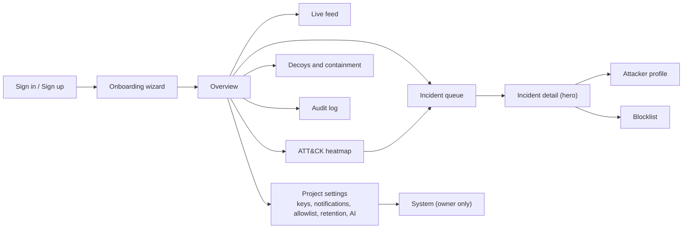
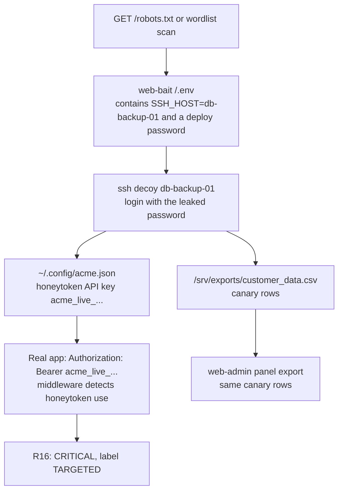

---

## 6. The web dashboard

### 6.1 Design principles (from S1 and S4, made concrete)

1. **The first screen is the answer.** The top bar always reads like "2 critical · 1 high · 14 noise suppressed" for the selected time range.
2. **Label decides the queue, severity decides the order.** Noise is collapsed into a counter; opportunistic is a batch-review tab; targeted is the main queue.
3. **Explain every number.** Every severity has a "Why?" panel listing rule, points, reason and evidence links.
4. **AI next to evidence, never instead of it.** The AI summary is labelled and sits beside the deterministic timeline.
5. **One click to act, one row in the audit log.** Actions confirm what will happen ("Block 203.0.113.66 in Acme Shop for 24 h") and show their applied state.
6. **Attacker text is data.** Commands, usernames, user agents and paths render as escaped monospace text, truncated with "show more".
7. **No jargon without a tooltip.** Every ATT&CK id shows its name and a one-line description on hover.

### 6.2 Information architecture



Navigation: a left sidebar (Overview, Live feed, Incidents, Attackers, ATT&CK, Decoys & containment, Blocklist, Audit, Settings) and a project switcher. Organisation and team management screens are deferred (A1); the MVP organisation has one owner.

### 6.3 Screen specifications

| Screen | Purpose | Shows | Actions | Endpoints | Reads / modifies |
|---|---|---|---|---|---|
| **Sign in / up** | Access | Email/password form | Sign up, sign in, sign out | `/api/auth/*` (Better Auth) | `user`, `session` |
| **Onboarding wizard** | Get from zero to first event in < 10 minutes | Checklist mirroring diagram steps 0–5, each with copyable commands; live "waiting for sensor" and "waiting for first event" indicators driven by the stream; "Run simulation" button | Create project, create key (shown once), copy snippets, run replay | `POST /v1/projects`, `POST /v1/projects/:pid/keys`, `GET /v1/projects/:pid/onboarding`, `POST /v1/projects/:pid/demo/replay`, SSE | `projects`, `api_keys` |
| **Overview** | Answer in 3 seconds | Top bar counts by severity and label; open targeted incidents; mini live feed; noise-vs-targeted ratio; decoy health strip; median time to acknowledge | Jump to incident; filter time range; toggle "include simulated" | `GET /v1/projects/:pid/overview`, SSE | read only |
| **Live feed** | Watch activity as it happens | Streaming rows: time, source, decoy, event type, short detail, severity chip of its incident; pause; filters (decoy, type, source, simulated) | Pause/resume; click row → incident or attacker | `GET /v1/projects/:pid/events`, SSE `event.created` | read only |
| **Incident queue** | Prioritised triage | Tabs: Targeted · Opportunistic · Noise (count) · Resolved. Rows: severity, score, label, source IP, kill-chain mini-bar, ATT&CK chips, AI one-liner, last activity, status | Acknowledge, resolve, bulk-resolve noise, open | `GET /v1/projects/:pid/incidents`, `PATCH /v1/incidents/:iid`, SSE `incident.upserted` | `incidents.status` |
| **Incident detail (hero)** | The PS use case on one screen | Header (severity, score, label, source); six-stage kill-chain bar + "Real asset reached" and "Honeytoken used" badges; ATT&CK chips; timeline grouped by stage; "Why critical?" factors with evidence links; AI summary (labelled, with "Template" badge on fallback); commands and credentials tried (masked per policy); assets touched; notes; this incident's audit trail | Block source (with expiry), Unblock, Export IOCs (JSON/CSV/STIX), Acknowledge, Resolve, Mark false positive, Add note | `GET /v1/incidents/:iid`, `GET /v1/incidents/:iid/events`, `POST /v1/incidents/:iid/actions`, `PATCH /v1/incidents/:iid`, `POST /v1/incidents/:iid/notes`, `GET /v1/projects/:pid/iocs` | `response_actions`, `blocklist_entries`, `incidents`, `incident_notes`, `audit_logs` |
| **Attacker profile** | Everything about one source | First/last seen, sessions, decoys touched, real assets touched, client banners and user agents, bot-vs-human cadence, credentials tried, commands, files, techniques, linked incidents, block status | Block / unblock, export IOCs | `GET /v1/projects/:pid/attackers`, `GET /v1/attackers/:aid` | `blocklist_entries` |
| **ATT&CK heatmap** | Coverage and trends | Tactic columns × technique cells, coloured by count in range; click-through to incidents | Change range | `GET /v1/projects/:pid/attack-matrix` | read only |
| **Decoys & containment** | Safety proof and sensor health | Per decoy: type, mount, persona, status, last event, last heartbeat. Per container: declared posture (network mode, read-only, caps, user, limits) vs last `selftest` result with timestamp. Agent version and buffer/drop stats. | Copy `selftest` command; view report | `GET /v1/projects/:pid/decoys`, `GET /v1/projects/:pid/containment`, SSE `decoy.health` | read only |
| **Blocklist** | Manage enforced blocks | IP, reason, source incident, created by, expires, applied-on-sensors status | Unblock, extend, add manually | `GET/POST /v1/projects/:pid/blocklist`, `DELETE /v1/projects/:pid/blocklist/:bid` | `blocklist_entries`, `projects.policy_version` |
| **Audit log** | Accountability | Actor, action, target, metadata, time, IP | Filter, export CSV | `GET /v1/projects/:pid/audit` | read only |
| **Settings** | Configure the project | Ingest keys (prefix, created, last used, revoke); notification channels; allowlist CIDRs; retention; AI narration on/off; credential capture mode | Create/revoke key; add/test webhook; edit settings | `/v1/projects/:pid/keys*`, `/v1/projects/:pid/notification-channels*`, `PATCH /v1/projects/:pid` | `api_keys`, `notification_channels`, `projects` |
| **System** (owner) | Is the platform healthy? | Ingest rate, queue depth, failed jobs, LLM success rate and latency, agents and versions, stream connections | Retry failed job | `GET /v1/system` | pg-boss tables |

### 6.4 Incident detail wireframe

```
┌────────────────────────────────────────────────────────────────────────────────┐
│ INCIDENT #7  ● CRITICAL 100   TARGETED   203.0.113.66   first 10:41 · last 10:43│
│ Recon ━ Initial Access ━ Execution ━ Discovery ━ Collection ━ Exfiltration      │
│   ✔          ✔              ✔           ✔            ✔            ·            │
│ [REAL ASSET REACHED: Payments API]  [HONEYTOKEN USED: acme_live_…3f]            │
│ T1595.003  T1110.001  T1078.001  T1059.004  T1083  T1082  T1005  T1552.001       │
├──────────────────────────────────┬─────────────────────────────────────────────┤
│ Timeline                         │ Why critical?                               │
│ 10:41:02 web  GET /admin, /.env  │ +5  touched a decoy (R01)          ev #1    │
│ 10:41:40 ssh  5 failed logins    │ +5  swept 3 decoys in 60 s (R02)   ev #2-4  │
│ 10:41:52 ssh  admin / ***** ✔    │ +10 brute force (R04)              ev #5-9  │
│ 10:42:05 ssh  $ ls -la /srv      │ +25 default credentials worked (R06) ev #10 │
│ 10:42:17 ssh  $ cat customer_…   │ +5  interactive session (R07)               │
│ 10:43:10 app  GET /api/payments  │ +10 discovery commands (R08)                │
│          status 200, watched IP  │ +10 decoy data accessed (R11)               │
│                                  │ +40 targeted source reached a real asset    │
│                                  │     (R15) → floor CRITICAL         ev #18   │
├──────────────────────────────────┴─────────────────────────────────────────────┤
│ AI summary (generated 10:43:31)                                                │
│ A human-paced attacker logged into a decoy backup server with default          │
│ credentials, read fake customer data, then called your real Payments API.     │
│ Recommended: block 203.0.113.66 and review Payments API access logs.          │
│ [ Block source · 24 h ]  [ Export IOCs ▾ ]  [ Acknowledge ]  [ Resolve ▾ ]     │
└────────────────────────────────────────────────────────────────────────────────┘
```

### 6.5 Onboarding and "no-hassle" usability

| User | Friction we remove | How |
|---|---|---|
| Developer | "Where do I start?" | Wizard mirrors diagram steps; every command is copyable; the checklist ticks itself from real events |
| Developer | "Will this break my app?" | Middleware fails open; `monitor` mode; benchmark numbers in the docs |
| Developer | "Is it safe?" | `selftest` output shown in the dashboard |
| Analyst | "Is this real?" | Labels, "Why?" panel, evidence links |
| Analyst | "What do I do?" | Recommended actions as buttons; playbook per severity (§7.7) |
| Judge / new user | "Show me" | "Run simulation" replays a full scenario in ~60 seconds on an empty project |
| Everyone | Empty screens | Every empty state says what will appear and how to make it appear |

---

## 7. Honeypots and security infrastructure

### 7.1 Which decoys, and what each detects

| Decoy | Tier | Emulates | Detects | Typical ATT&CK |
|---|---|---|---|---|
| `web-admin` (`/admin`) | Core | Admin login → fake panel → "Export customers" | Path probing, credential guessing, default-credential use, data collection | T1595.003, T1110.001, T1078.001, T1005 |
| `web-bait` (`/.env`, `/backup.sql`, `/.git/config`, `/wp-login.php`) | Core | Leaked secrets and backups (fake) | Secret hunting, wordlist scanning, theft of bait data, exploit sprays | T1595.003, T1552.001, T1005, T1190 |
| `ssh` (Cowrie persona) | Core | A Linux server (`db-backup-01`) with bait files | Brute force, default creds, shell use, discovery, tool download, persistence, tunnelling attempts | T1110, T1078.001, T1059.004, T1083, T1082, T1033, T1105, T1053.003, T1098.004, T1090 |
| Honeytokens (data, not a service) | Essential (E1) | A fake API key in the same format as real keys, canary rows with unique emails | Use of stolen decoy data against the real app — zero false positives | T1552.001 (read), T1078 (use) |
| `redis` | Essential, first to cut (E9) | Unauthenticated or weak-password Redis with seeded keys | Exposed-database attacks, `CONFIG SET dir`, `REPLICAOF`, `MODULE LOAD` persistence attempts | T1046, T1078, T1053-style persistence |
| Docker Engine API, IoT camera + Telnet, Postgres wire | Advanced (A5) | — | Container deployment, botnet Telnet brute force | T1610, T1611, T1496 |

The PS asks for at least one realistic decoy; we ship two protocol families (web, SSH) plus honeytokens, which is enough depth for one connected story.

### 7.2 Deception design: decoys that lead into each other

S4's key insight, kept: one attacker should produce **one chain across several decoys**, ending at the real app.



Rules for believability: realistic hostnames, file dates and `/etc/os-release`; a believable SSH banner; fake data obviously fake to humans who look closely (`example.com` emails, test card ranges never used), never real personal data.

### 7.3 Provisioning and configuration

1. Developer declares decoys (§5.3).
2. `build` resolves each decoy into a container definition, config files and bait content, and records declared posture in the manifest.
3. `docker compose up` starts them; the agent registers the manifest, which creates or updates `decoys` rows.
4. Configuration changes go through the same path (edit → build → up). There is no remote configuration in the MVP, deliberately: a platform compromise cannot reconfigure customer sensors.

Persona images: `lxs/cowrie-personas` is built in our repo `FROM cowrie/cowrie@<digest>`. At image build time it adds each persona's fake filesystem entries (Cowrie stores the fake directory tree as a pickled file that has to be edited with Cowrie's own filesystem tool) and command outputs. Per-deployment content (honeytokens, canary rows) is mounted read-only at runtime. Verify the exact Cowrie config keys and in-image paths against the pinned release during Phase 2.

### 7.4 How decoys talk to the platform

They don't. Every decoy writes JSON lines to its own log volume; `ds-agent` mounts those volumes read-only, normalises and ships. This is the main containment property of the design: an attacker with code execution inside a decoy finds no credential, no network route, and no socket other than its own.

### 7.5 Capture and normalisation

**Cowrie → DecoyEvent mapping** (event ids to be verified against the pinned Cowrie version):

| Cowrie `eventid` | `event_type` | Key fields |
|---|---|---|
| `cowrie.session.connect` | `connection.open` | `src_ip`, `src_port`, `session_id` |
| `cowrie.client.version` | `ssh.client` | `client_banner` |
| `cowrie.client.kex` | `ssh.client` | HASSH kept in `raw` (A3) |
| `cowrie.login.failed` / `.success` | `auth.attempt` (`outcome`) | `username`, password per §7.13 |
| `cowrie.command.input` / `.failed` | `command.exec` | `command` (≤ 4 KB) |
| `cowrie.session.file_download` / `.failed` | `file.download` | `url`, `file_sha256` when present |
| `cowrie.session.file_upload` | `file.upload` | `file_name`, `file_sha256`, `file_size` |
| `cowrie.direct-tcpip.request` | `proxy.attempt` | destination in `dst_service` |
| `cowrie.session.closed` | `connection.close` | duration in `raw` |
| anything else | dropped, counted | — |

Loopback sources (the container's own health check) are dropped during normalisation.

**`ds-web` log line** (internal format, normalised by the agent):

```json
{"ts":"2026-11-01T10:41:02.120Z","decoy_id":"web-admin-admin","kind":"login","ip":"203.0.113.66",
 "method":"POST","path":"/admin/login","ua":"Mozilla/5.0","username":"admin","password":"admin",
 "accepted":true,"req_id":"01JC8Z4T7Q..."}
```

**The one event schema** — S4's flat `DecoyEvent`, adjusted (server-assigned fields removed, `decoy_id`, `count`, `simulated`, `asset_name` added). Flat is easy to index and to export to ECS later.

```ts
// packages/schema/src/event.ts  (zod 4)
import { z } from 'zod';

export const EventType = z.enum([
  'connection.open', 'connection.close', 'http.request', 'auth.attempt', 'command.exec',
  'file.download', 'file.upload', 'proxy.attempt', 'ssh.client', 'db.command',
  'honeytoken.read', 'honeytoken.use', 'asset.access', 'asset.blocked',
  'prod.firewall', 'prod.auth',
]);

export const DecoyEvent = z.object({
  id: z.ulid(),                                  // generated by the agent; idempotency key
  schema_version: z.literal(1),
  timestamp: z.iso.datetime(),                   // sensor clock (UTC); platform also stores received_at
  sensor: z.enum(['web', 'ssh', 'redis', 'sdk', 'prod']),
  decoy_id: z.string().max(64).optional(),       // stable id from decoy.config.ts
  is_decoy: z.boolean(),                         // false for sdk/prod signals about real assets
  session_id: z.string().max(128).optional(),
  src_ip: z.union([z.ipv4(), z.ipv6()]),
  src_port: z.number().int().min(0).max(65535).optional(),
  dst_service: z.string().max(128),              // "ssh:22", "http:/admin", "app:/api/payments"
  event_type: EventType,
  outcome: z.enum(['success', 'failure', 'unknown']).optional(),
  username: z.string().max(256).optional(),
  password_clear: z.string().max(128).optional(),   // only if in the bundled common-credentials list
  password_masked: z.string().max(128).optional(),  // "a***n"
  password_sha256: z.string().length(64).optional(),// sha256(project salt + password)
  command: z.string().max(4096).optional(),
  method: z.string().max(16).optional(),
  url: z.string().max(2048).optional(),
  status_code: z.number().int().optional(),
  user_agent: z.string().max(512).optional(),
  payload: z.string().max(4096).optional(),      // body excerpt; never executed
  file_name: z.string().max(512).optional(),
  file_sha256: z.string().length(64).optional(),
  file_size: z.number().int().nonnegative().optional(),
  client_banner: z.string().max(256).optional(),
  asset_name: z.string().max(128).optional(),
  honeytoken_id: z.string().max(64).optional(),
  count: z.number().int().positive().default(1), // > 1 when the agent aggregated repeats
  simulated: z.boolean().default(false),
  raw: z.record(z.string(), z.unknown()).optional(), // original record, capped at 4 KB
});
export type DecoyEvent = z.infer<typeof DecoyEvent>;
```

Example (from the targeted scenario):

```json
{
  "id": "01JC8Z4T7Q2W9F0X1M3N5P7R9S", "schema_version": 1,
  "timestamp": "2026-11-01T10:42:17.311Z", "sensor": "ssh", "decoy_id": "ssh-db-backup-01",
  "is_decoy": true, "session_id": "ssh-db-backup-01:7f3a", "src_ip": "203.0.113.66",
  "src_port": 51544, "dst_service": "ssh:22", "event_type": "command.exec", "outcome": "success",
  "username": "admin", "command": "cat /srv/exports/customer_data.csv", "count": 1, "simulated": false
}
```

### 7.6 Classification, ATT&CK, kill chain, scoring and labels

Detection is two pure functions in `packages/detection`, unit-tested with golden fixtures:

- `tagEvent(event, ctx)` → `{ category, techniques[], stage, ruleHints[] }` for one event.
- `evaluateChain(events, ctx)` → `{ detections[], score, severity, label, stagesReached[], realAssetReached, honeytokenUsed }` for one incident.

**Kill chain** (six stages, S4 / master prompt): Recon → Initial Access → Execution → Discovery → Collection → Exfiltration. Persistence, Credential Access, Defense Evasion and Command and Control appear as ATT&CK tactic chips under the bar. "Real asset reached" and "Honeytoken used" are badges, not stages.

**Severity bands** (S4 / master prompt): Low < 25 · Medium 25–49 · High 50–74 · Critical ≥ 75. Displayed score is capped at 100. Floors override points and are sticky for the life of the incident.

**Rule table** (S4's R01–R18, with the changes marked):

| ID | Family | Signal | Points (cap) | ATT&CK (confidence) | Stage |
|---|---|---|---|---|---|
| R01 | recon | Touched any decoy (path, port) | +5 once | T1595 Active Scanning (0.7) | Recon |
| R02 | recon | Sweep: ≥ 3 distinct decoys/paths in 60 s | +5 | T1595.003 Wordlist Scanning / T1046 Network Service Discovery (0.8) | Recon |
| R03 | recon | Known scanner UA or SSH client banner (nmap, masscan, zgrab, sqlmap, nikto, gobuster, nuclei, hydra, libssh) | +3 | T1595.002 Vulnerability Scanning (0.8) | Recon |
| R04 | credential | ≥ 5 failed logins in 60 s | +10 | T1110.001 Password Guessing (0.9) | Initial Access |
| R05 | exploit | SQLi, XSS, traversal or command-injection signature in a decoy request | +10 per type (20) | T1190 Exploit Public-Facing Application (0.7) | Initial Access |
| R06 | access | Successful login on a decoy with default/weak credentials | +25 | T1078.001 Default Accounts (0.9) | Initial Access |
| R07 | execution | Session with ≥ 3 commands | +5 | T1059.004 Unix Shell (0.9) | Execution |
| R08 | discovery | Discovery commands (`ls`, `pwd`, `whoami`, `id`, `uname`, `ps`, `cat /etc/passwd`, Redis `INFO`/`KEYS *`) | +5 per distinct (10) | T1083, T1033, T1082, T1057, T1087.001 (0.8) | Discovery |
| R09 | execution | Tool transfer: `wget`, `curl`, `tftp`, SCP upload | +15 | T1105 Ingress Tool Transfer (0.8) | Execution |
| R10 | persistence | `crontab`, writing `authorized_keys`, Redis `CONFIG SET dir` / `REPLICAOF` / `MODULE LOAD` | +20 | T1053.003 Cron / T1098.004 SSH Authorized Keys (0.8) | Execution |
| R11 | collection | Accessed decoy data (`customer_data.csv`, `/backup.sql`, panel export) or read a honeytoken file | +10 | T1005 Data from Local System (0.8); T1552.001 Credentials in Files (0.8) | Collection |
| R12 | spread | Same source on ≥ 2 decoy types | **0 — label signal** [CHANGED from +10] | — | — |
| R13 | behaviour | Human cadence: ≥ 3 actions, median gap ≥ 1.5 s, variable gaps | **0 — label signal** [CHANGED from +5] | — | — |
| R14 | behaviour | Revisit after > 10 min idle | +5 | — | — |
| R15 | correlation | Watched source touched a real asset (SDK `asset.access` or telemetry) | **By pre-correlation label** [CHANGED]: targeted +40, floor Critical · opportunistic +20, floor High · noise +10, no floor · +10 if the asset is declared `critical` | T1078 Valid Accounts (0.6) where credentials were used | badge |
| R16 | honeytoken | A honeytoken was used anywhere | +50, floor Critical, label forced Targeted | T1078 / T1552.001 (0.95) | Exfiltration |
| R17 | evasion | `history -c`, deleting logs, `unset HISTFILE` | +10 | T1070.003 Clear Command History (0.9) | Execution |
| R18 | exfil | Decoy data left the decoy (bait file served, panel export downloaded) | +0 (tag only) | T1041 Exfiltration Over C2 Channel (0.6) | Exfiltration |
| R19 | tunnelling | SSH port-forwarding request | +10 | T1090 Proxy (0.8) | Execution |

Why the changes: R12 and R13 describe *who* the attacker is (human, multi-decoy), which is the label's job; giving them points pushed S4's own worked example to Critical before the real-asset moment. R15 now depends on what the source did on the decoys first, because public honeypots and public apps are both scanned by the same bots every day; flooring every such bot at High would recreate alert fatigue. R19 is added for Cowrie's forwarding attempts.

**Labels** (S4's three, made computable):

| Label | Rule | Queue treatment |
|---|---|---|
| Noise | Only R01–R05 fired; no successful auth; no R13 | Collapsed into "N noise suppressed"; never notifies |
| Opportunistic | Got in (R06) or executed (R07/R09/R10) with bot cadence and common credentials | Opportunistic tab, batch review |
| Targeted | Any of: R13 human cadence; R16; successful login with credentials **not** in the common list; R12 together with any access; R15 when already targeted | Main queue, notifies at High and Critical |

The label is computed twice: once from decoy activity only (the **pre-correlation label** that R15 uses), then finally after R15/R16.

**Worked example — the PS use case, as the demo will show it:**

| # | Attacker action | Rule | Points | Running score | Severity |
|---|---|---|---|---|---|
| 1 | Connects to the SSH decoy | R01 | +5 | 5 | Low |
| 2 | Probes `/admin`, `/.env`, `/backup.sql` within a minute | R02 | +5 | 10 | Low |
| 3 | 5 failed SSH logins | R04 | +10 | 20 | Low |
| 4 | Logs in with `admin` / `admin` | R06 | +25 | 45 | Medium |
| 5 | Runs 3+ commands (human-paced → label Targeted via R13) | R07 | +5 | 50 | High |
| 6 | `ls -la`, `uname -a` | R08 | +10 | 60 | High |
| 7 | `cat /srv/exports/customer_data.csv` | R11 (+R18 tag) | +10 | 70 | High |
| 8 | Same IP calls the real `/api/payments` (declared critical) | R15 (targeted) | +40 +10, floor Critical | 120 → 100 | **CRITICAL** |
| 9 | (optional) Uses the honeytoken key from `acme.json` | R16 | +50, floor | 100 | CRITICAL |

Noise scenario: R01 5 + R02 5 + R03 3 + R04 10 = **23, Low, Noise**. Opportunistic bot (common creds, scripted `uname; wget`): 5 + 10 + 25 + 5 + 5 + 15 = **65, High, Opportunistic** — visible, batched, not paging anyone.

### 7.7 How analysts investigate (IR workflow, from S4)

Detect (decoy touch) → Triage (label, score, "Why?") → Investigate (timeline, attacker profile, assets touched) → Contain (Block source; rotate any real credentials the attacker could have seen) → Eradicate (patch or harden the touched real asset) → Recover (block expires or is lifted; keep watching) → Learn (export IOCs, tune allowlist and rules).

| Severity | Response target | Default playbook shown in the UI |
|---|---|---|
| Critical | Immediately | Block source; review the touched real asset's logs; rotate credentials adjacent to any used honeytoken; open an internal incident |
| High | < 1 h | Block source; review the chain; check real-asset logs |
| Medium | Same day | Review in batch; consider blocking |
| Low / Noise | None | Auto-suppressed; weekly IOC export |

### 7.8 Monitoring and maintaining the decoys

- **Health:** Docker health checks + `restart: unless-stopped`; the agent reports per-decoy status (`up` / `down` / `unknown`), last event time and log-volume disk usage in each 30 s heartbeat.
- **Staleness:** a platform job marks a sensor `stale` after 90 s without a heartbeat and `offline` after 10 minutes, emitting `decoy.health` to the stream and a Containment-panel warning.
- **Updates:** images are pinned by digest; an SDK upgrade bumps them; `build --check` in CI catches drift.
- **Log growth:** Cowrie rotates its JSON log daily; the Docker `local` log driver caps container logs; disk usage alerts at 80 %.

### 7.9 Language choice for honeypots

| Option | Pros | Cons | Verdict |
|---|---|---|---|
| Cowrie (Python, upstream) for SSH | Proven realism; many emulated commands; TTY logs; no code to maintain | Python in the stack; persona filesystem must be baked at image build; we parse its logs | **MVP** |
| ssh2 + TS shell (S4) | One language; total control; asciicast output directly; dev mode without Docker | A day of work to reach believable; every missing command is a tell | Advanced, only if Cowrie blocks us |
| TS for web decoys and Redis | Same language as SDK and agent; simple protocols | — | **MVP** (web), Essential (Redis) |
| Python for future tooling (enrichment, YARA on quarantined uploads) | Best libraries | Second toolchain | Later, as separate jobs |

### 7.10 Isolation and containment

**Per-container controls**

| Control | `ds-web` | `ds-ssh` | `ds-redis` (opt.) | `ds-agent` |
|---|---|---|---|---|
| Network | `none` | `ds_trap` only, published port | `ds_trap` only, published port | `ds_uplink` only |
| Read-only root filesystem | ✔ | ✔ (+ writable log/data volumes, small tmpfs) | ✔ | ✔ |
| Non-root user | ✔ 10002 | ✔ image's `cowrie` user | ✔ 10003 | ✔ 10001 |
| `cap_drop: [ALL]` | ✔ | ✔ | ✔ | ✔ |
| `no-new-privileges` | ✔ | ✔ | ✔ | ✔ |
| Default seccomp + AppArmor | ✔ | ✔ | ✔ | ✔ |
| Memory / CPU / PIDs | 128 MB / 0.25 / 64 | 256 MB / 0.5 / 128 | 128 MB / 0.25 / 64 | 256 MB / 0.5 / 128 |
| Holds secrets | Honeytokens only (fake by design) | Honeytokens only | Honeytokens only | Ingest key |
| Can execute attacker input | No (static templates) | No (emulated shell, no real processes) | No (parser only) | No |

**Why not `internal: true`?** Docker does not publish ports for containers attached only to internal networks, so attackers could not reach the decoys (S4 A2). Web decoys avoid networking entirely; network decoys use a normal bridge whose outbound traffic is shut at three layers: masquerading disabled on the bridge, inter-container traffic disabled, and host firewall rules.

**Host firewall (Linux victim host, installed once by `infra/victim/ds-firewall.sh`):**

```bash
#!/usr/bin/env bash
set -euo pipefail
# Containers on the trap bridge may not open NEW connections anywhere through the host
iptables -C DOCKER-USER -i br-ds-trap -m conntrack --ctstate NEW -j DROP 2>/dev/null \
  || iptables -I DOCKER-USER -i br-ds-trap -m conntrack --ctstate NEW -j DROP
# ...nor to the host itself (its sshd, Docker-published ports, metadata services)
iptables -C INPUT -i br-ds-trap -m conntrack --ctstate NEW -j DROP 2>/dev/null \
  || iptables -I INPUT -i br-ds-trap -m conntrack --ctstate NEW -j DROP
# Replies to inbound attacker sessions are ESTABLISHED and still pass.
# Persist with iptables-persistent (or the nftables equivalent) and verify after Docker restarts.
```

Verify on the demo VM in Phase 1 that the `DOCKER-USER` chain exists with the host's firewall backend (iptables-nft vs nftables) and that rules survive a Docker restart. Docker Desktop (macOS/Windows) runs inside a VM where these rules cannot be applied from the host; there, development is fine but containment claims are not, and the docs say so.

**Cloud metadata:** cloud VMs expose a metadata service at a link-local address; the INPUT/DOCKER-USER rules above block decoys from reaching it. `selftest` checks it explicitly.

**`npx lxs selftest`** (what judges see):

```
$ npx lxs selftest
[ds-ssh-db-backup-01] -> 1.1.1.1:443               BLOCKED  ✔
[ds-ssh-db-backup-01] -> host 172.31.250.1:22      BLOCKED  ✔
[ds-ssh-db-backup-01] -> 169.254.169.254:80        BLOCKED  ✔
[ds-ssh-db-backup-01] -> shop:3000                 BLOCKED  ✔ (no route, no DNS)
[ds-ssh-db-backup-01] -> platform api:443          BLOCKED  ✔
[ds-web]              network interfaces           lo only  ✔
[ds-web]              agent socket                 ABSENT   ✔
[all decoys]          read-only rootfs, caps ALL dropped, no-new-privileges, non-root, limits  ✔
[host]                DOCKER-USER + INPUT rules    PRESENT  ✔ (run with sudo to check)
[ds-agent]            -> platform /healthz         ALLOWED  ✔ (expected)
Containment: PASS (10/10)   report sent: yes
```

Probes run with `docker exec` using the interpreter already in each image (`node -e` in distroless images, `python3 -c` in Cowrie), so no extra tools are added to attacker-reachable containers.

### 7.11 Safe handling of attacker-controlled input

| Where | Limit / rule |
|---|---|
| Log lines read by the agent | Max 64 KB per line (longer lines dropped and counted); JSON parse with depth limit |
| Event fields | Lengths as in the schema; `raw` capped at 4 KB; control characters stripped from display copies |
| `ds-web` request bodies | 16 KB max; parsed only on decoy login routes |
| Ingest | 500 events per batch; 1 MB compressed / 5 MB uncompressed; per-event validation |
| Dashboard rendering | React escaping only; no HTML rendering of attacker data; strict CSP |
| CSV export | Cells beginning with `=`, `+`, `-`, `@`, tab or CR are prefixed with `'` (formula injection) |
| LLM input | Max 20 commands × 200 chars; wrapped as quoted JSON data; never passwords |
| File uploads to Cowrie | Stored hash-named in the decoy's data volume, never executed; only hash/size/name shipped in MVP |

### 7.12 Abuse prevention

- Decoys cannot be used as proxies, spam relays or scanners: no egress, Cowrie forwarding disabled.
- Floods: the agent collapses repeated auth failures from one source (after 20 per minute) into `count` events; per-key ingest rate limits; the LLM never runs for noise and has a daily per-project cap.
- Resource exhaustion: CPU, memory and PID limits on every decoy.
- The simulator refuses targets it was not configured for.

### 7.13 Data retention and privacy

| Data | Default retention | Notes |
|---|---|---|
| Events | 30 days | `raw` nulled after 7 days |
| Incidents, detections, attackers | 180 days | |
| AI summaries | With the incident | |
| Audit logs | 1 year | Append-only |
| Passwords tried | With the event | Clear text only if in the bundled common-credentials list; otherwise masked + salted hash (S4 A9) — protects employees who type a real password into the fake `/admin` |
| Cookies / Authorization headers | Never stored | Stripped by the middleware before reaching `ds-web` |

IP addresses can be personal data in some jurisdictions; processing is for security purposes, documented in `docs/security.md`, with per-project retention controls. [OPEN] whether sending attacker strings to a third-party LLM is acceptable for every customer (AI narration can be switched off per project).
